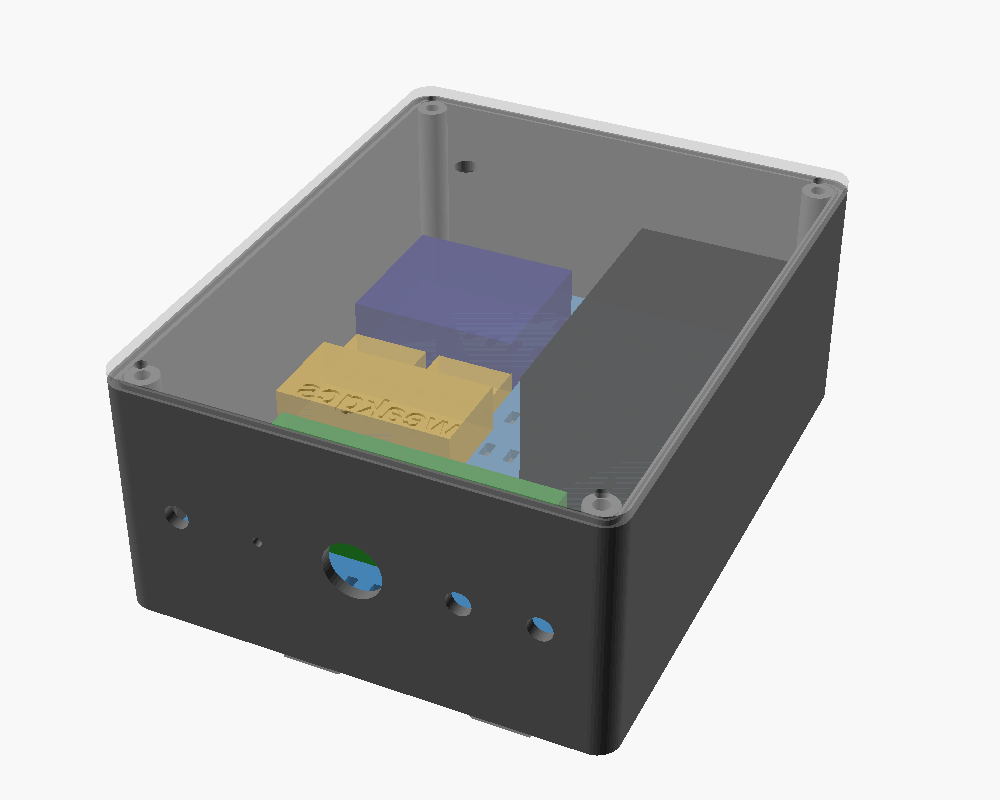

# Obudowa masztu (druk 3D)

Parametryczny projekt w OpenSCAD: [`mast_box.scad`](mast_box.scad). Gotowe pliki STL są w [`stl/`](stl/).



**Stan:** projekt na podstawie wymiarów katalogowych (Nomad 80×45×40 mm) i szacunkowych (reszta).
Nic nie zostało jeszcze wydrukowane ani przymierzone. **Zanim wydrukujesz pudełko (ok. 8–10 h),
zmierz swoje elementy i sprawdź parametry** (sekcja niżej). Najpierw wydrukuj bracket i płytkę
montażową: są małe i szybko pokażą, czy otwory oraz wtopki pasują.

## Części

| Plik | Wymiary [mm] | Jak drukować |
|---|---|---|
| `stl/box.stl` | 130 × 165 × 66 | plecami na stół (otwór do góry), bez podpór |
| `stl/lid.stl` | 130 × 165 × 6 | zewnętrzną stroną na stół (napis od spodu) |
| `stl/plate.stl` | 123 × 158 × 3 | płasko |
| `stl/bracket.stl` | 70 × 120 × 25 | płaską stroną (tą od obudowy) na stół; tunele na paski mostkują się bez podpór |

Wszystko mieści się na stole 180 × 180 mm (Bambu Lab A1 mini).

**Materiał:** **ASA** (najlepiej, odporny na UV) albo **PETG**. Nie PLA: mięknie na słońcu i
pod wpływem ciepła z modułu ELRS. A1 mini nie ma obudowy, więc ASA drukuj w miejscu bez przeciągów,
a jeśli się odkleja albo pęka, wybierz PETG.

**Ustawienia:** warstwa 0,2 mm, 4 obrysy (ścianki będą lite), 5 warstw góra/dół, wypełnienie 25–30 %
(gyroid). Pudełko i pokrywa: 3,2 mm ścianki = 8 obrysów przy dyszy 0,4, czyli praktycznie lite.

## Układ

Obudowa wisi na maszcie pionowo: plecy przy maszcie, pokrywa z przodu.
**Wszystkie otwory są w dolnej ściance**, więc woda nie wlewa się do środka.

```
            widok od przodu (bez pokrywy)
   ┌──────────────────────────────────────┐  ▲ góra
   │ (●)                              (●) │
   │  ┌────────────┐      ┌───────────┐   │      (●) wkręty pokrywy (wtopki M3)
   │  │ SteadyView │      │           │   │
   │  └────────────┘      │  Nomad    │   │
   │  ┌─────┐┌─────┐      │  (ELRS)   │   │      patch 5,8 GHz: gniazdo SMA w pokrywie,
   │  │ 5 V ││ 5 V │      │           │   │      nad SteadyView
   │  └─────┘└─────┘      │           │   │
   │  ┌──────────────┐    └───────────┘   │
   │  │ 12 V (XL4015)│                    │
   │  └──────────────┘                    │
   │   ┌───────────────────────┐          │
   │   │   Olimex ESP32-POE    │          │
   │   └───────────────────────┘          │
   │ (●)                              (●) │
   └──┬───────┬─────────┬───────┬────┬────┘
     SMA    drenaż   dławik    SMA  SMA
    5,8 GHz          PG9     ELRS  ELRS
    (dookólna)    (skrętka)  (2 anteny Nomada)
```

- Anteny 5,8 GHz (lewa strona) i ELRS (prawa strona) są możliwie daleko od siebie.
- Anteny dookólne wiszą pionowo w dół, a patch jest skierowany do przodu, czyli w stronę lotu.
  Ustawiasz go, obracając całą obudowę na maszcie.
- Anteny łączysz przez **przedłużki SMA z gniazdem panelowym (bulkhead)**: gniazdo w ściance,
  wtyk do modułu.

## Mocowanie do masztu

Bracket z rowkiem w kształcie V pasuje do rur o różnej średnicy (ok. 16–50 mm). Ma:

- 2 tunele na **paski na rzep do 25 mm**,
- 2 tunele na **opaski zaciskowe do 5 mm**.

Bracket przykręcasz do pleców obudowy 3 wkrętami M3 wchodzącymi we wtopki wciśnięte **od zewnątrz**
w nieprzelotowe otwory. Plecy obudowy zostają szczelne.

## Potrzebne drobiazgi

| Co | Ile | Na co |
|---|---|---|
| Wtopki gwintowane M3 (np. M3 × 5, Ø zewn. ok. 4,5–5 mm) | 11 | 4 pokrywa, 4 płytka montażowa, 3 bracket |
| Wkręty M3 × 8 (łeb walcowy, nierdzewne) | 11 | pokrywa, płytka, bracket |
| Sznur uszczelniający Ø 2 mm (silikon/EPDM) albo uszczelka wydrukowana z TPU | ok. 0,6 m | rowek w krawędzi obudowy |
| Dławik kablowy PG9 (zakres 4–8 mm) | 1 | skrętka |
| Przedłużka SMA bulkhead (gniazdo panelowe ↔ wtyk), RG316, 10–15 cm | 4 | 2× Nomad, 1× SteadyView dookólna, 1× SteadyView patch (pokrywa) |
| Opaski zaciskowe 2,5 mm, taśma dwustronna (montażowa) | – | elementy na płytce montażowej |
| Filament ASA lub PETG | ok. 300 g | |

**Średnica otworu pod wtopki** (`insert_d = 4.0`) dobierz do swoich wtopek: zwykle podaje ją producent.
Zmieniasz jedną liczbę i generujesz pliki ponownie.

## Montaż

1. Wtopki wciskasz lutownicą (ok. 220–250 °C, końcówka do wtopek lub zwykły grot):
   - 4 w narożnikach obudowy (pokrywa),
   - 4 w słupkach na dnie (płytka montażowa),
   - 3 od zewnątrz w plecach (bracket).
2. W dolną ściankę wkręć dławik PG9, przedłużki SMA (nakrętki od środka, podkładki od zewnątrz)
   i przetkaj drenaż (Ø 2,5 mm) igłą.
3. Elementy przymocuj do płytki montażowej opaskami przez szczeliny albo taśmą dwustronną według
   schematu wyżej, połącz przewodami (patrz [docs/assembly.md](../../docs/assembly.md)), a płytkę
   przykręć do słupków.
4. Skrętkę przez dławik zrób z pętlą okapową: kabel najpierw schodzi niżej niż dławik, potem wchodzi
   do góry, żeby woda ściekała z kabla, a nie po nim do środka.
5. Włóż sznur uszczelniający w rowek, przykręć pokrywę na krzyż, z wyczuciem.
6. Przykręć bracket i przymocuj obudowę do masztu paskami lub opaskami.

## Parametry do sprawdzenia przed drukiem

Wszystkie są na górze `mast_box.scad`:

| Parametr | Domyślnie | Sprawdź |
|---|---|---|
| `L`, `H`, `D` | 130, 165, 66 | czy wszystko się mieści (w `preview` widać szare bryłki elementów) |
| pozycje w `preview()` | szacunkowe | wymiary SteadyView V3.3, przetwornic, Olimexa |
| `insert_d`, `insert_h` | 4,0 / 6 | specyfikacja Twoich wtopek |
| `gland_d` | 15,6 | gwint dławika (PG9 ≈ 15,2 mm) |
| `sma_d` | 6,6 | gwint gniazda SMA bulkhead (zwykle 1/4", 6,35 mm) |
| `patch_x`, `patch_y`, `patch_sma` | 34, 125, true | gdzie chcesz patch, albo `false`, jeśli patch na osobnym uchwycie |

## Generowanie plików

```bash
cd hardware/enclosure
for p in box lid plate bracket; do openscad -D "part=\"$p\"" -o stl/$p.stl mast_box.scad; done
```

Podgląd całości: otwórz `mast_box.scad` w OpenSCAD (domyślnie `part = "preview"`).

## Ciepło

Nomad przy 1 W mocno się grzeje. W UE i tak nadajesz z małą mocą (2,4 GHz: do 100 mW EIRP,
868 MHz: do 25 mW), więc ciepła jest dużo mniej. Mimo to po złożeniu zrób test z
[docs/assembly.md](../../docs/assembly.md) (krok 8): 30 minut pracy w zamkniętej obudowie
na słońcu, potem pomiar temperatury modułu.
